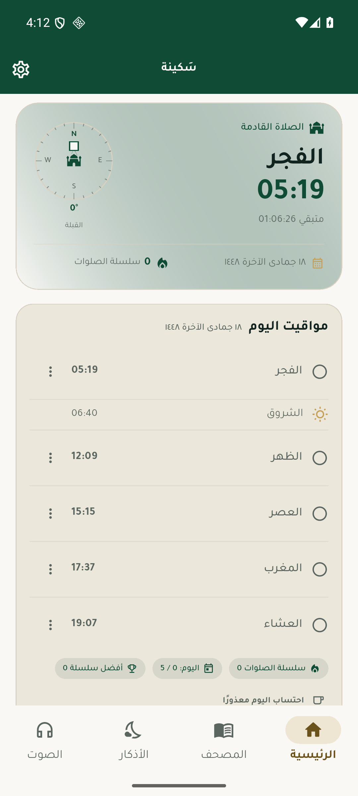
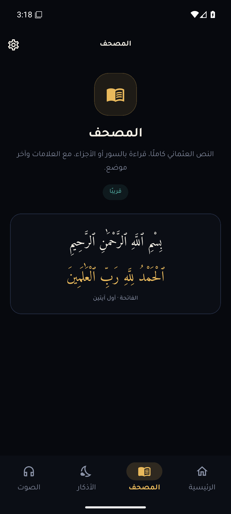
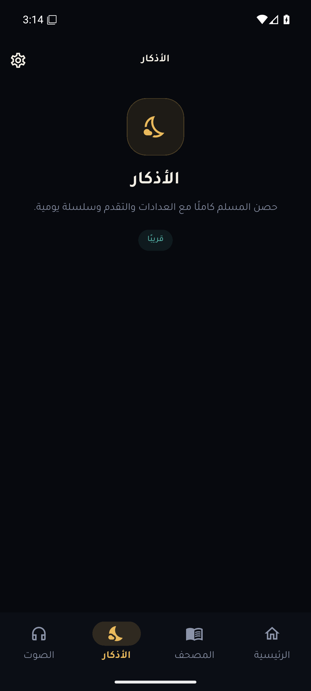
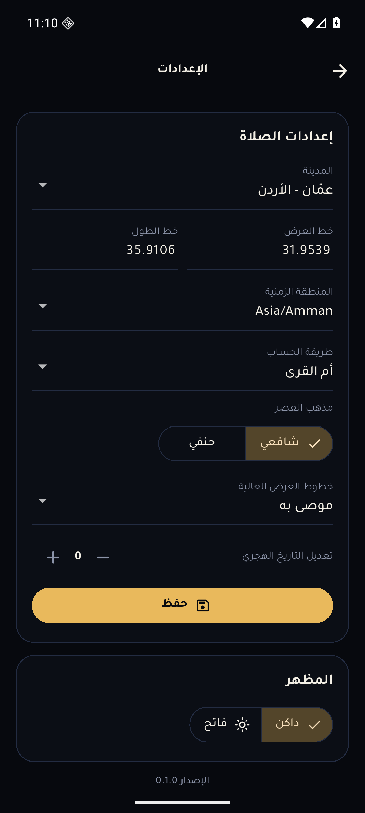

# Sakeenah Mobile

Flutter client for Android and iOS. The desktop app lives in the repository root;
this directory is an independent Flutter project that shares the brand, content
and prayer calculations but not the desktop runtime.

## Status

Phase **M1** — offline data layer.

- Arabic-first UI with `flutter_localizations` and generated ARB accessors.
- Bottom navigation: Dashboard, Mushaf, Adhkar, Audio.
- Dark and light themes built from the same colour tokens as desktop.
- Tajawal for UI text and Amiri Quran for Quranic text, both bundled offline.
- Drift database with tested schema migrations and bundled content seeding.
- Offline prayer methods, Hijri conversion and qibla bearings.

The full Uthmani Quran (114 surahs, 6236 ayahs) and Hisn al-Muslim (126
categories, 302 items) are seeded from bundled assets on first launch. Screens
that consume them arrive in M2–M4.

## Data layer

```
lib/data/
  db/app_database.dart      Drift schema v2 (content + user state)
  models/                   Surah, Ayah, Adhkar, ...
  repositories/             read-only content interfaces
  seed/                     QuranSeeder, AdhkarSeeder
  worship/                  prayer methods, Adhan wrapper, Hijri, qibla
  app_services.dart         startup seeding and shared repositories
```

- `ContentBootstrap` loads `assets/data/quran.json` and
  `assets/data/adhkar.json` once and seeds them in a single transaction.
  A stored `content_version` plus complete row counts skips all asset I/O on
  later launches; bumping the version refreshes bundled content while keeping
  user state.
- Schema v1 held Quran/adkhar content; v2 added settings, bookmarks, reader
  position, adhkar progress/logs and the prayer log; v3 stores prayer and
  adhkar streak days as `YYYY-MM-DD` local dates. Step-by-step migrations and
  a generated schema test cover v1 → v2 → v3.
- Quran text is inserted verbatim; tests compare every stored row against the
  bundled source, verify the asset is byte-identical to the desktop bundle,
  and check the Tanzil XML hash.
- Calculation methods match the desktop catalogue (Umm al-Qura, MWL, Egyptian,
  Karachi, Dubai, Moonsighting, ISNA, Kuwait, Qatar, Singapore, Tehran,
  Turkey), with the seventh-of-the-night high-latitude rule. Returned times are
  wall-clock values on the requested local date for the supplied UTC offset.
- Hijri dates use Umm al-Qura tables and support the desktop-style day
  adjustment. Qibla bearings are computed offline from coordinates.

Attribution and licence files live next to the assets:
`QURAN_LICENSE.md` (Tanzil, CC BY 3.0) and `ADHKAR_LICENSE.md`
(HisnElMuslim, MIT). Package and font notices are listed in
[`THIRD_PARTY_NOTICES.md`](THIRD_PARTY_NOTICES.md). `scripts/build-quran.mjs`
writes both the desktop and mobile Quran bundles from the same XML.

## Reliability

- Native SQLite comes from `sqlite3` 3.x native assets; no platform channel
  setup is required.
- Startup runs behind a catch-all: a failed database open or seed shows an
  Arabic recovery screen with a retry button instead of a blank splash.
- Seeders skip completed collections; the version gate avoids reading the
  1.7 MB Quran asset on every launch.
- Tests use in-memory databases, real bundled assets and generated migration
  snapshots.


## Requirements

- Flutter 3.50.1 stable (Dart 3.14).
- JDK 17 for the Android build.
- Android SDK with platform 36, build-tools 36.0.0 and NDK 28.2.13676358.
- Xcode 16+ on macOS for the iOS compile check.

The project targets `app.sakeenah.mobile`, `minSdk 26`, `targetSdk 36`.

## Commands

```bash
flutter pub get
flutter gen-l10n          # also runs automatically on pub get/build
flutter analyze
flutter test
flutter build apk --debug
flutter build ios --debug --no-codesign   # macOS only
```

The debug APK is written to `build/app/outputs/flutter-apk/app-debug.apk`.

## Layout

```
lib/
  app.dart                  MaterialApp, locale and theme mode
  shell/app_shell.dart      Bottom navigation and app bar
  features/                 dashboard, quran, adhkar, audio, settings
  l10n/                     Arabic template and English translation
  theme/sakeenah_theme.dart Colour tokens and ThemeData
  widgets/                  shared cards and placeholders
assets/fonts/               bundled fonts and their OFL licences
```

## Screenshots

Captured on an Android 16 (API 36) emulator at 1080x2400 in Arabic RTL.

| Dashboard | Mushaf | Adhkar |
|---|---|---|
|  |  |  |

| Audio | Settings (dark) | Settings (light) |
|---|---|---|
|  |  |  |

## Localisation

`lib/l10n/app_ar.arb` is the template. Add a key there first, then mirror it in
`app_en.arb`. Arabic is the only locale shipped in v1; English stays complete so
a later release can enable it without reworking screens.

## CI

`.github/workflows/mobile.yml` runs analyze, tests and a debug APK build on
Ubuntu, plus an unsigned iOS compile on macOS. Both jobs must stay green before
a mobile release.
