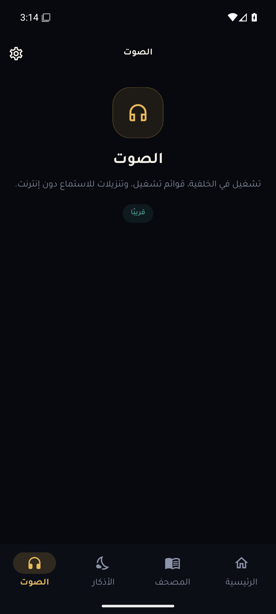
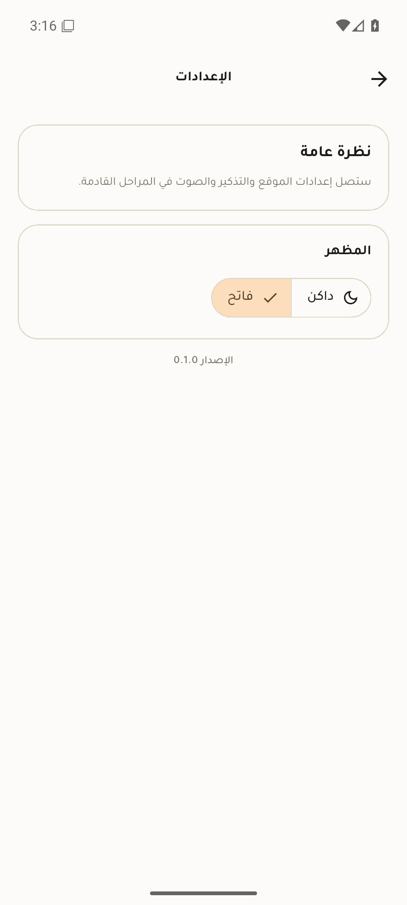

# Sakeenah Mobile

Flutter client for Android and iOS. The desktop app lives in the repository root;
this directory is an independent Flutter project that shares the brand, content
and prayer calculations but not the desktop runtime.

## Status

Phase **M0** — toolchain, scaffold and design system.

- Arabic-first UI with `flutter_localizations` and generated ARB accessors.
- Bottom navigation: Dashboard, Mushaf, Adhkar, Audio.
- Dark and light themes built from the same colour tokens as desktop.
- Tajawal for UI text and Amiri Quran for Quranic text, both bundled offline.
- No network dependency and no platform channels yet.

Quran text shown in this phase is a small visual preview for the design system;
the full Uthmani dataset arrives in M1.

## Requirements

- Flutter 3.50.1 stable (Dart 3.14).
- JDK 17 for the Android build.
- Android SDK with platform 36, build-tools 36.0.0 and NDK 28.2.13676358.
- Xcode 16+ on macOS for the iOS compile check.

The project targets `app.sakeenah.mobile`, `minSdk 26`, `targetSdk 36`.

## Commands

```bash
flutter pub get
flutter gen-l10n          # also runs automatically on pub get/build
flutter analyze
flutter test
flutter build apk --debug
flutter build ios --debug --no-codesign   # macOS only
```

The debug APK is written to `build/app/outputs/flutter-apk/app-debug.apk`.

## Layout

```
lib/
  app.dart                  MaterialApp, locale and theme mode
  shell/app_shell.dart      Bottom navigation and app bar
  features/                 dashboard, quran, adhkar, audio, settings
  l10n/                     Arabic template and English translation
  theme/sakeenah_theme.dart Colour tokens and ThemeData
  widgets/                  shared cards and placeholders
assets/fonts/               bundled fonts and their OFL licences
```

## Screenshots

Captured on an Android 16 (API 36) emulator at 1080x2400 in Arabic RTL.

| Dashboard | Mushaf | Adhkar |
|---|---|---|
|  |  |  |

| Audio | Settings (dark) | Settings (light) |
|---|---|---|
|  |  |  |

## Localisation

`lib/l10n/app_ar.arb` is the template. Add a key there first, then mirror it in
`app_en.arb`. Arabic is the only locale shipped in v1; English stays complete so
a later release can enable it without reworking screens.

## CI

`.github/workflows/mobile.yml` runs analyze, tests and a debug APK build on
Ubuntu, plus an unsigned iOS compile on macOS. Both jobs must stay green before
a mobile release.
